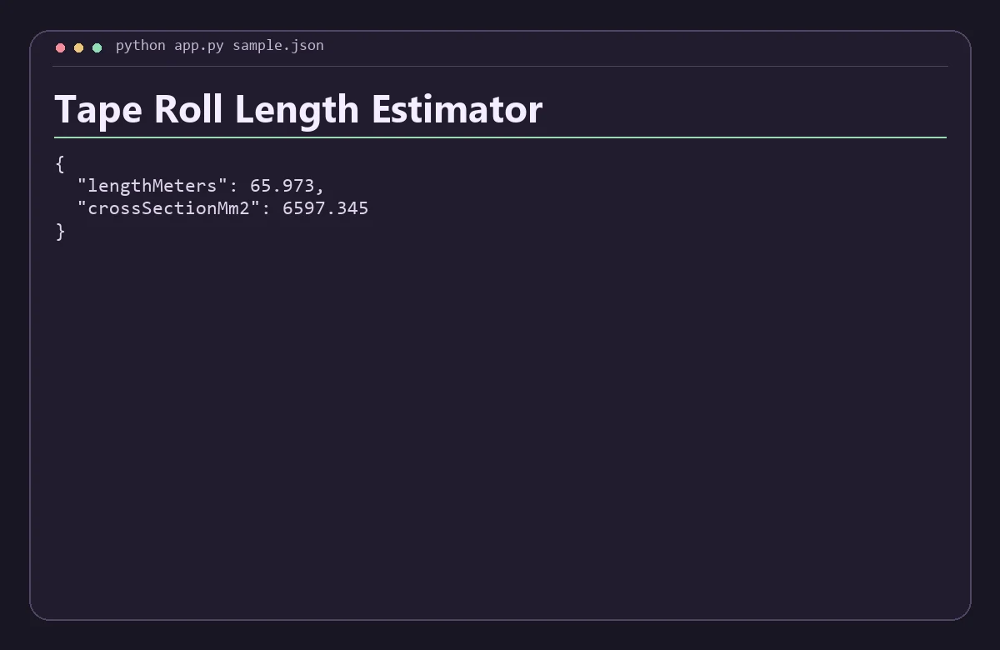

# Tape Roll Length Estimator

Estimate remaining tape or film length from a roll diameter, core diameter, and material thickness.



## Run

Install Python 3.11 or newer. Run these commands from the repository root.

```sh
python app.py sample.json
```

Replace `sample.json` with a JSON file following the same structure. The app prints a JSON report to standard output.

Dimensions are in millimeters. The calculation divides the roll cross-sectional area by material thickness and assumes tight winding, constant thickness, and a round core. Outer diameter must be at least the core diameter.

## Verify

Run `python check.py` with Python 3.11 or newer after the build step when applicable. The check verifies the bundled scenario and confirms that an invalid input returns an error.
